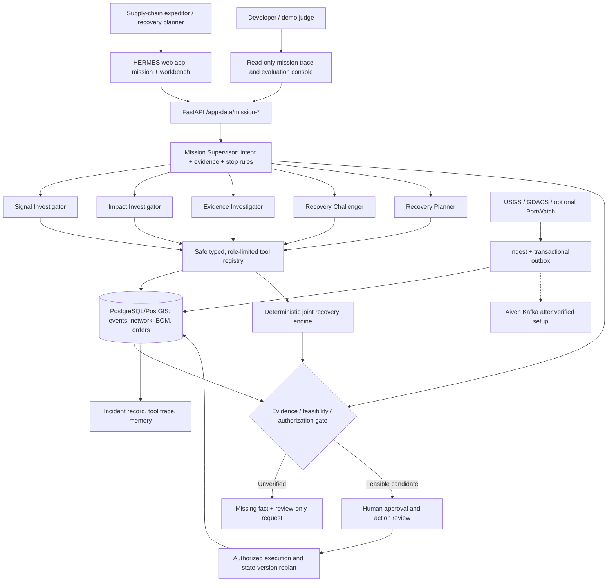

# HERMES — MULTI-AGENT MISSION ARCHITECTURE (v11)
**22 October 2026 | Engineering decision | Backend branch feat/db-foundation**

## Context and competitive thesis

The team provided an architecture reference showing Next.js/React frontends for expeditor and developer, a FastAPI route layer, a ChatbotManager with session and query-type routing, a Semantic Kernel AgentGroupChat with selection and termination strategies, specialist scheduling/reporting/political-risk agents, plugins, Azure SQL/blob storage and model-based grounding.

**Do not cargo-cult that stack.** We already have Python FastAPI, Postgres/PostGIS, normalized sources, a transaction outbox, a 266,737-row **modeled** private dataset, a deterministic recovery solver and a React/Vite frontend. We should retain these functioning assets. Our differentiator is *proof that a recovery decision is operationally feasible*, not the presence of four animated agent avatars.

**HERMES Recovery Mission:** Observe → retrieve explicit routes → challenge proposed recovery → request missing evidence → run deterministic cross-SKU solver → route human approval → record state and replan. The model must select relevant bounded tools and explain their output; the solver/DB decides facts.

## Reference diagram → HERMES architecture

### What is already implemented and VERIFIED in code (not all deployed)

- Four preexisting tool-calling specialist definitions: Signal, Impact, Evidence, Recovery; `dependency.agents.runtime.run_agent` uses OpenAI Responses API function tools and records a tool trace. The old Recovery Planner spec also has tools which **write** draft requests/approvals; do NOT give those to the general chat endpoint.
- New **`dependency.assistant.mission_controller.mission_preview`** is a read-only deterministic control plane: evidence-gated selection of event, journey, optional SKU graph, exact approved backup independent-check and optional scenario portfolio; no unconfirmed scenario → no recovery calculation; returns timed tool trace, source paths, challenge results, next required action and safe gate. **It is a deterministic baseline, NOT a multi-agent LLM run.**
- New **`dependency.assistant.mission_agents.run_supervised_agents`** is optional model-driven specialist execution: picks signal/impact/evidence/challenger by the actual evidence/scenario state, then each agent may choose permitted read-only tools. Strict allowlist blocks outreach preparation, supplier request/dispatch, approval request, state writes or protected execution. Maximum three tool rounds per specialist. Two explicit opt-ins required: server `DEPENDENCY_MISSION_MODEL_ENABLED=1` with model key, and request `consent_to_model=true`. No model call by default. **Code path exists but paid live runs and costs are not yet independently benchmarked.**
- Existing `/app-data/ask` remains largely deterministic chat retrieval with optional model wording. New mission endpoints are separate; the frontend has not yet been wired to them.
- Existing `event_journey` returns six true database checkpoints; `product_dependency_graph` now exposes destination-qualified modeled `allocation_routes`. Unlike shared-material overview arrows, these routes cannot produce false cross-factory paths.
- Existing solver supports shared factory capacity and deterministic material-reduction repair across modeled BOMs. This is NOT fully optimal time-phased global MILP.
- Existing event polling and evidence tasks work locally, but the Aiven broker itself is still NOT_VERIFIED.

**New API endpoints**
- `POST /app-data/mission-preview`: JSON `{"event_id":"...","sku":"JI2993","question":"Which backup can actually protect orders?"}`; completely read-only and free; returns `mode=DETERMINISTIC_SUPERVISOR_BASELINE`, `tool_trace`, `backup_challenges`, `decision_gate`, `recovery` (only when an operational scenario exists), metrics and source paths.
- `POST /app-data/mission-agents`: same fields + `"consent_to_model": true`; server must also allow model use. Returns `mode=OPT_IN_MODEL_SPECIALISTS`, deterministic baseline, each specialist's tool trace/output and the same non-execution rule. Model privacy and running costs require explicit authorization.

### Agent selection / termination policy (not decorative round-robin)

| Recorded case state | Specialists selected | Stop / handoff rule |
| --- | --- | --- |
| No scenario, no SKU | Signal → Evidence | Stop with missing fact or no modeled exposure; do not invent a plan |
| No scenario, selected SKU | Signal → Impact → Evidence | Show qualified modeled links, outstanding task; stop before operational recovery |
| Scenario + selected SKU | Signal → Impact → Recovery Challenger | Challenge physical routes; solver is deterministic source of feasibility; no agent execution |
| Missing backend facts / tool error | Stop immediately | `INCOMPLETE_TOOL_ERROR`; no unsupported conclusion |
| Specialist exceeds max tool rounds or fails | Stop | Show incomplete trace; never promote a guessed answer into a decision |

**A complete mission is not defined by an LLM writing "done."** Completion means either grounded answer, exact missing evidence for a human, independently confirmed candidate requiring approval, or an explicit safe failure/no-private-link.

### Typed plugin/tool boundary

Read-only tools presently available include source event retrieval, near-facility search, stored event evidence and tasks, BOM explosion, exact modeled upstream routes, SKU commitments, backup independence, supplier capacity, dated purchase orders and deterministic event portfolio. The model may select among tool names from its explicitly allowed specialist set. It does not receive arbitrary SQL or a free-form network browser.

**Separate action workflow** (not available to agents in this mission): prepare a review-only outreach draft; collect an operator-confirmed private fact; request human approval; execute only after approval; record state version and replan. These are backend state transitions with authorization and audit, not tool calls from chat.

### Data and memory

The source of business truth is existing PostgreSQL/PostGIS, not model context. Distinguish four data states: `VERIFIED_PUBLIC`, `PUBLIC_DERIVED`, `INFERRED`, and `SIMULATED_PRIVATE`. Public proximity never proves factory closure. Customer commitments attach to SKU, not a proven material shipment or supplier order assignment.

Needed *future* session layer, not yet implemented:
- `mission_sessions`: session ID, actor/tenant, incident ID, selected event/SKU, state-version snapshot, creation/last activity, permissions.
- `mission_turns`: question, selected tool references and output hashes, factual conclusion/unknowns, model usage and human action link; bounded retention.
- `mission_tool_calls`: tool name, arguments (redacted for protected fields), row/record reference, elapsed_ms, provenance, state version, errors (type only), cost/tokens when available.
- resumable checkpoints for long-running investigations; pause at `AWAITING_EVIDENCE` or `APPROVAL_REQUIRED`, resume when new source/operational state arrives, and invalidate stale findings.
- cross-session memory only from approved incident outcomes, **not** self-reinforcing model guesses.

The operational `incident_evidence`, `incident_plan_history`, `agent_runs`, `incident_outcomes` and `operational_state_version` tables already store relevant facts; do not duplicate those records blindly in chat sessions.

### Counterfactual challenger — distinct feature

For the strongest SKU in the Cianjur REPLAY:
1. Proposer suggests alternate factory.
2. Challenger compares actual source/material/destination allocations of primary vs backup, calls deterministic `check_backup_independence`, and returns a decision with specific shared upstream IDs.
3. It checks BOM/component availability, dated material arrival, factory-wide weekly capacity shared across all SKUs, substitute approvals, and customer due dates **only via existing validated solver/tool outputs**. If those checks aren't implemented or evidence is missing, return `UNASSESSED` or `EVIDENCE_REQUIRED`, not PASS.
4. Ask: **"What smallest change makes this recovery feasible?"** Explore bounded, structured alternatives via deterministic scenarios. Require explicit material/capacity dates rather than invented values. This counterfactual search is still **planned**, not shipped with the mission preview.
5. Human confirms facts / authorized execution; planner recalculates, challenger reruns against new version. The expeditor sees exactly why the plan changed.

No competitor-comparison proof is valid without an actual head-to-head task, so do not claim unique market exclusivity.

## Frontend design requirements, matching reference without copying it

**Expeditor tab**: Ask HERMES at top, source/case context, two-line objective, 3–5 understandable progress steps (read evidence, find dependencies, challenge backup, review recovery, ask human), compact citations and "why" explanations. Back every stage with an actual tool_trace row. Let operator click a cited factory/material/commitment. Show measured elapsed time, unconfirmed state, next valid action.

**Engineer / judge tab**: same mission ID with a read-only execution trace: selected specialist, function name, sanitized arguments, endpoint/data source, tool elapsed time, actual DB state version, alternative rejection reason, model usage/tokens (when instrumented), cost, final evidence gate. Do not display fake cost or "agent collaboration" animations for a deterministic run.

**Recovery workbench**: source → material → approved destination factory → SKU → SKU-level commitments, constrained quantities, supplier evidence, plan vs challenger result, before/after version and distinct approval/execution. Keep the map as a drill-down. Do not build six different dashboards.

## Measurable benchmarks and judge proof

Evaluate 20+ cases (10 normal/5 adversarial/5 negative, if feasible) using seeded data and changing controlled inputs:
- zero invented supplier→destination links and zero false claims that a SKU order was fulfilled by named supplier;
- no recovery without a confirmed operational scenario;
- all correlated backups caught on exact modeled routes;
- every tool invocation actually occurred and is timestamped (no narrated fake tools);
- replay an event twice, produce one first-receipt and one incident;
- scenarios where input capacity falls across two SKUs, material allocations do not double spend;
- elapsed_ms p50/p95 for mission preview and real model-assisted flow, retries/failures, number of tools, provider cost/tokens if available;
- explicit manual analyst baseline for the same unknown backup investigation and expeditor answer accuracy/grounding; do not invent % savings.

**Rubric:** clear expeditor and purchase value; true multi-step agent selection/tools; data quality & freshness/scale/memory; timed accuracy/cost metrics; surprising polished demo + viable enterprise launch.

## Engineering plan with three people

**Backend Engineer (data and solver)**: add exact dated material/factory feasibility + confidence limits, strengthen counterfactual challenger tool to call existing solver safely, integrate rejected reasons and source IDs with unit tests. Own `src/dependency/solver/*` and scenario/constraint tests.

**Full-Stack Engineer (supervisor and UX)**: wire private frontend to new `/app-data/mission-preview`; create read-only judge trace view; adapt to optional model-assisted endpoint only with explicit privacy/cost approval; build real disposable PostgreSQL+Chromium acceptance, fix stale app context. Own `app/*`, `src/dependency/assistant/*`, frontend tests; coordinate API changes before editing main.py.

**Lead (product, eval, Aiven)**: deliver the real Cianjur 3-min flow, link safe test fixture/private frontend to team, measure p50/p95 latency and user task time, verify Aiven Kafka if actually provisioned, enforce no fake data or effects, merge only green CI. Do not reset owner's populated Windows database.

## What remains unfinished (no false "v11 done" claims)

1. Durable multi-turn session API/history, model usage accounting, safe checkpoints and resumable investigations.
2. Production authorization (user/tenant/permission checks), result-level redaction and replay protections; dev endpoints are not safe for internet-exposed deployment.
3. Fully dynamic agent/supervisor planner beyond evidence-gated role selection; testing paid model tool decisions in real environment.
4. Multi-period global physical optimization and confirmed shipments/orders, authenticated supplier identity and approval-backed external side effects.
5. Real managed Aiven broker + source-change version stream, and full deployed mobile/browser tests.
6. Private frontend integration of new mission endpoints (no backend GitHub commit can update owner's unshared site).

**The important technical result this milestone:** an auditable deterministic supervisor, an opt-in strict-read-only model specialist path and adversarial backup checking wired to actual backend services. No Cianjur-specific conditional logic. No additional database migrations, seed resets or paid model calls were performed by this change.
